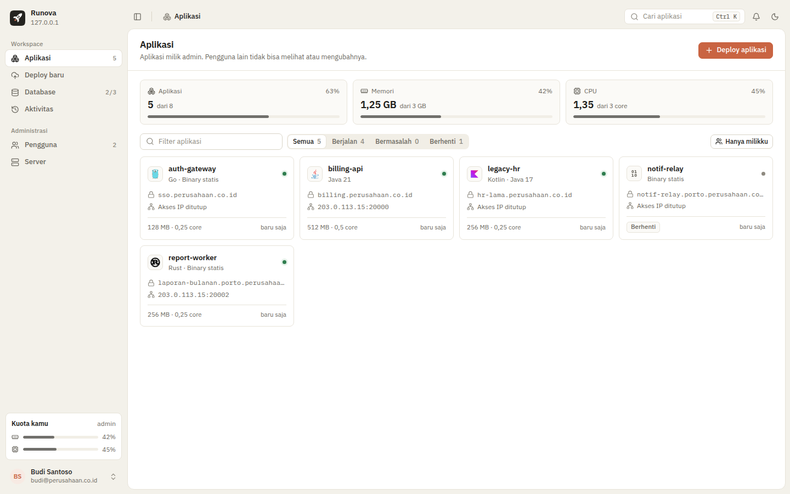
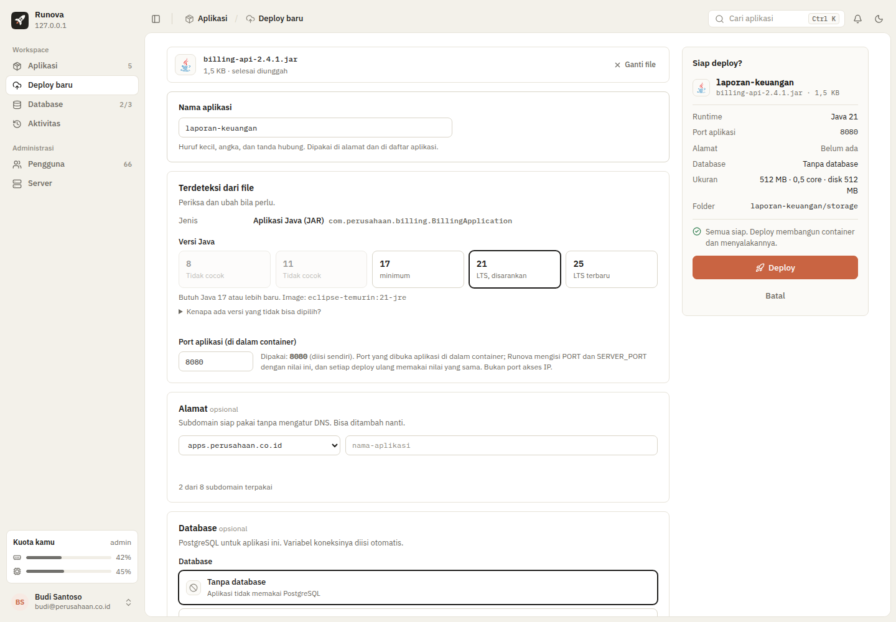
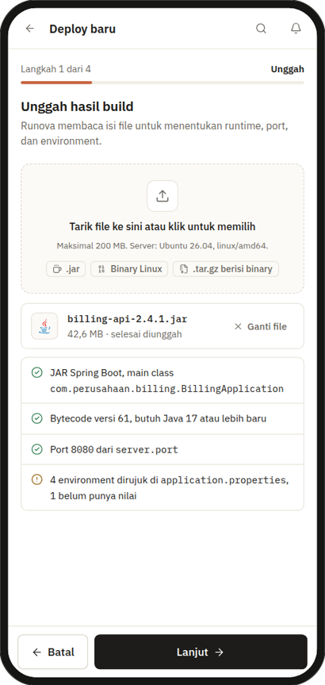
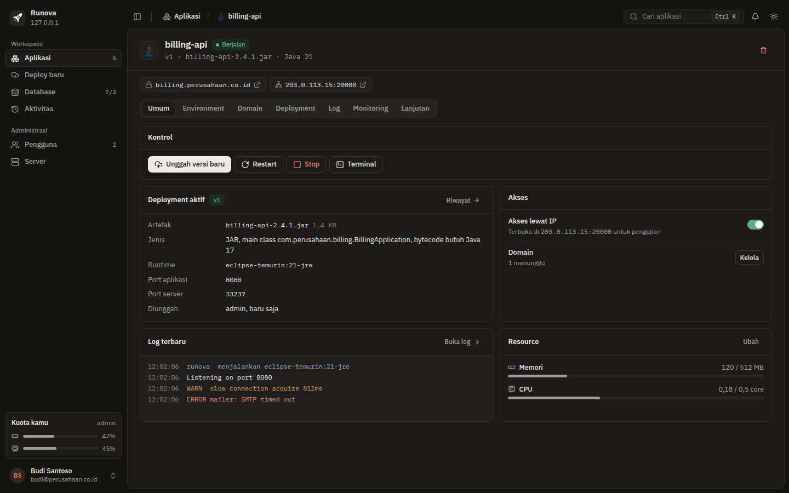
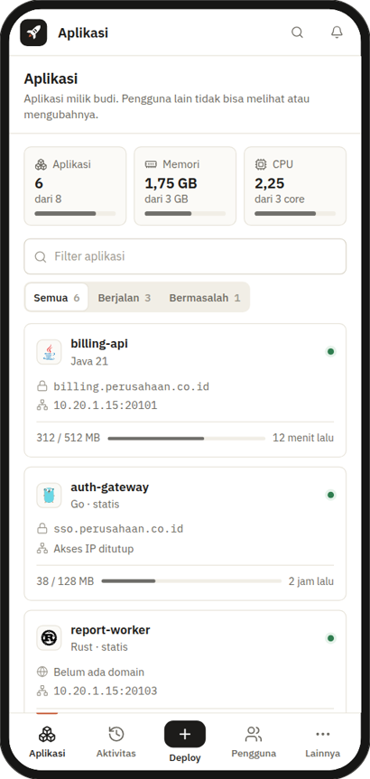
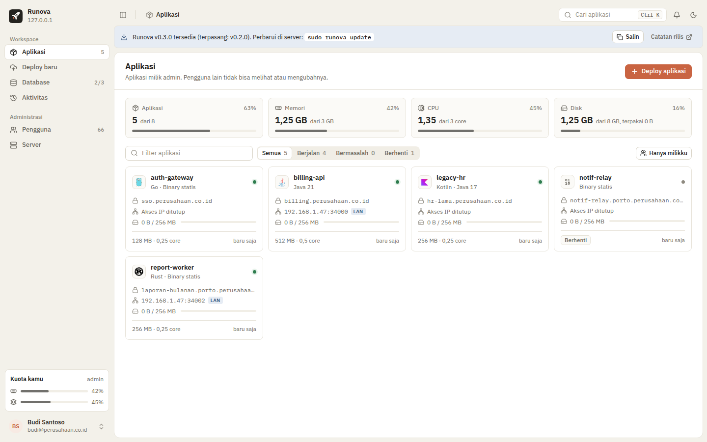
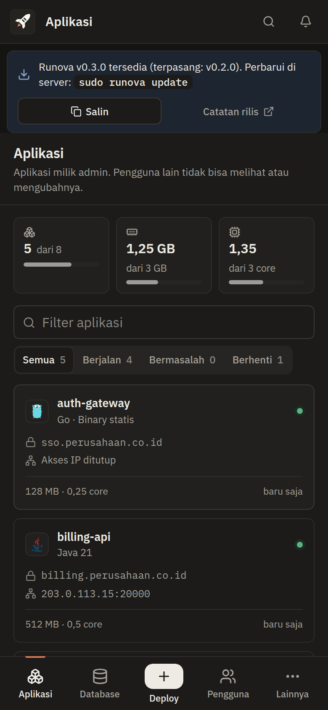

<p align="center">
  
</p>

<h1 align="center">Runova</h1>

<p align="center"><b>English</b> · <a href="README.id.md">Bahasa Indonesia</a></p>

<p align="center">
  A self-hosted panel for running build artifacts, not source code.<br>
  Upload a <code>.jar</code> or Linux binary, configure environment variables, and your app runs on your own server with a custom domain and automated HTTPS.
</p>

<p align="center">
  <a href="https://github.com/aribrilliantsyah/runova/releases/latest"></a>
  <a href="https://github.com/aribrilliantsyah/runova/actions/workflows/ci.yml"></a>
  <a href="LICENSE"></a>
</p>

<p align="center">
  <b>Status: feature-complete; installer proven on Ubuntu 26.04 with systemd in a container, not yet on bare metal or real VMs.</b> The <code>runova</code> binary bundles a JSON API and an embedded web panel; installer, updates (<code>runova update</code>/<code>rollback</code>), release scripts, and system tests are implemented (see <a href="#testing-status">Testing status</a> for what is verified and what is not).
  The <a href="preview-dashboard.html">interface preview</a> (open that file in a browser) serves as the design reference.
</p>

<p align="center">
  
</p>

## Why

Platforms like Vercel or Railway build applications from source code and run them in their cloud. Many internal teams already have finished build artifacts from their own pipelines (`.jar` files from Maven, Go or Rust binaries from CI) and simply need a single place on their office server to run them cleanly:

- **Upload, don't build.** Runova does not touch source code. It inspects uploaded files: file type, minimum required Java version, port, and referenced environment variables.
- **Isolated per user.** Each application runs in its own Docker container with memory and CPU limits. Users cannot see or touch applications belonging to other users.
- **Test via IP first, then assign a domain.** Applications can be accessed at `server-IP:port` for testing. An admin registers a wildcard domain once, after which users can assign their application an address like `name.registered-domain` without managing DNS; Caddy automatically provisions HTTPS certificates, and IP access can be closed.

## What can run

Admins choose which runtimes are allowed on the server. Runova detects the file type upon upload and displays its language logo.

| Type | Example languages | User options | Base image |
|---|---|---|---|
| **JAR** | Java, Kotlin, Scala, Clojure, Groovy | Java 8, 11, 17, 21, 25 | `eclipse-temurin:<version>-jre` |
| **Static binary** | Go, Rust (musl), Zig, Nim, Odin, V | – | `gcr.io/distroless/static-debian12` |
| **glibc binary** | Rust, C, C++, .NET, Swift, Haskell, Crystal, Dart, OCaml, Bun, Deno | – | `ubuntu:26.04` |

- `.jar` files have their bytecode version inspected. Java versions too old for the file cannot be selected, accompanied by an explanation.
- Binaries are validated for format (must be Linux ELF) and architecture (must match the server). Windows `.exe` files or macOS binaries are rejected with clear error messages.

## User flow

<table>
  <tr>
    <td width="66%"></td>
    <td></td>
  </tr>
</table>

Deployment is divided into four steps:

1. **Upload.** Drag and drop the file onto the page. Inspection results appear as a checklist.
2. **Runtime.** Select Java version (for `.jar`), JVM options, and the port the application listens on.
3. **Environment.** Variables referenced by the application appear as a form. Secret values are stored encrypted.
4. **Resources & access.** Allocate memory and CPU from remaining account quota. Enable IP access for testing, and set a domain when ready.

The **Deploy** button is only enabled after all required fields are satisfied. The summary panel indicates what is still missing.

Once running, the application page provides controls (upload new version, restart, stop, terminal), environment variables, domains, deployment history with rollback support, logs, monitoring, files, and advanced settings.

## Application files

Every application has a **workspace**, shown in the panel as `<app>/` (for example `starboom/`). It is the container's working directory (`/data`, also in `RUNOVA_DATA_DIR`), lives on the server at `/var/lib/runova/data/<user>/<app>/`, and keeps its files across redeploys, restarts and rollbacks. The rest of the container is read-only.

- An app that writes to a relative path such as `./storage` already writes into the workspace (`starboom/storage`).
- An app that writes to an absolute path such as `/app/storage` or `/var/www/uploads` gets that path **mounted automatically** from a workspace folder (`starboom/storage`). Runova finds such folders in `.env.example`, `application.properties` and `application.yml` (`spring.servlet.multipart.location`, `*.upload-dir`, `*.storage.*path*`, `STORAGE_PATH`, `UPLOAD_DIR`, …) without running the app; the review page lists them ticked under **Folder tersimpan**, and they can be changed there or in the app's **Lanjutan** tab. System folders (`/etc`, `/usr`, `/proc`, …), `/tmp` and the artifact itself are refused.
- The **File** tab lists the workspace, downloads and deletes files, and uploads small files.

## Users and quotas

- **Admin** registers users. There is no self-registration.
- Each user only sees and manages their own applications.
- Admins configure quotas per user: **number of applications, memory, CPU, number of databases** (default 3) **and disk** (default 1 GB). Users allocate that quota across their applications; each app gets a disk size at deploy (256 MB by default, changeable in **Lanjutan**).
- Disk counts everything in an app's workspace (its saved folders included); artifacts, logs and PostgreSQL databases do not count. Runova measures every workspace every 5 minutes and before each deploy. At 80% the owner is warned; at 100% the app shows **Disk penuh**, the owner gets an error notification and new deploys of that app are refused until files are deleted or the size is raised. The running app is **not** stopped, so no data is lost. This is a soft limit: an app can write past it until the next measurement. A hard limit needs a filesystem with project quotas (XFS `prjquota`), which stock Ubuntu installs do not have; that is future work. Admins see server disk use and the apps' share on the **Server** page.
- Applications exceeding their memory limit are killed and restarted by Docker without affecting other applications.

## Database

Runova installs **PostgreSQL 18** on the same server (official Ubuntu 26.04 package).

- Each user receives **one PostgreSQL account** upon admin registration, for example `budi`.
- Users create their own databases in the panel, with names prefixed by their username (`budi_billing`, `budi_auth`). The count is capped by admin quotas, defaulting to **3 per user**.
- Only the owner can access their database. User accounts have no superuser privileges, cannot create roles, and have connection limits.
- During deployment, users select a database for their application (or none). Runova automatically populates `DATABASE_URL`, `SPRING_DATASOURCE_URL`, and `PGHOST`/`PGPORT`/`PGUSER`/`PGPASSWORD`/`PGDATABASE`, plus every database variable the artifact names (`DB_URL`, `DB_USER`, `DB_PASSWORD`, `POSTGRES_PASSWORD`, `JDBC_URL`, `SPRING_R2DBC_URL`, `TYPEORM_*`, …), password included; those rows show as "Otomatis" and need no typing. A value the user enters for one of them wins. The host is `host.docker.internal`: this server, as seen from inside the container (what `localhost` is on the server). Multiple applications belonging to the same user may share the same database.
- Host, port, database name, and password can be viewed and copied on the **Database** page, for example to connect via DBeaver from networks permitted by the admin, or through an SSH tunnel (`ssh -N -L 5433:127.0.0.1:5432 <user>@<server>`, then `localhost:5433`).

## Installation

Requirements: clean Ubuntu Server 26.04 LTS (amd64), user with `sudo`, and internet access to Ubuntu apt repositories. The installer installs `docker.io`, `caddy`, `postgresql-18`, `ufw`, `jq`, and `curl` from official Ubuntu apt; no third-party repositories.

A complete guide for server admins (specifications, cloud firewall, DNS, backups, troubleshooting) is available in **[docs/install-ubuntu.md](docs/install-ubuntu.md)**. In summary, on the server:

```bash
# panel at https://panel.example.com (point DNS to server first)
curl -fsSL https://github.com/aribrilliantsyah/runova/releases/latest/download/get.sh | sudo bash -s -- --domain panel.example.com

# or panel at https://<server IP>:8443
curl -fsSL https://github.com/aribrilliantsyah/runova/releases/latest/download/get.sh | sudo bash -s -- --port 8443
```

`get.sh` downloads the latest release from [GitHub Releases](https://github.com/aribrilliantsyah/runova/releases), verifies `SHA256SUMS` (archive and its contents), then runs `install.sh` with your options. `--version 0.3.1` installs a specific version. Every release also includes build provenance [attestations](https://docs.github.com/en/actions/security-for-github-actions/using-artifact-attestations): `gh attestation verify runova-<version>-linux-amd64.tar.gz -R aribrilliantsyah/runova`.

From a source checkout (for instance, to test unreleased changes), `scripts/deploy.sh admin@IP-SERVER [options]` builds a local release, copies it over SSH, and runs the same installer.

`install.sh` options: `--domain <host>` or `--port <n>` (mutually exclusive; defaults to `--port 8443` without either), `--public-ip <ip>` (saved to settings; for servers behind NAT), `--skip-firewall` (do not touch `ufw`), `--yes` (non-interactive, for headless installations). For `--domain`, point that domain's DNS to the server first.

`--trusted-proxy <ip/cidr>` (repeatable) is for servers behind an nginx that forwards to Runova; see [nginx in front of Runova](docs/nginx-front-proxy.md).

At the end, the installer prints the panel address, username `admin`, and a random password **once only**. If lost: `sudo -u runova env RUNOVA_DATA=/var/lib/runova runova admin reset-password admin`.

What the installer does: creates user `runova` (`docker` group), encryption key, `/etc/runova/runova.env`, and systemd unit `runova.service`; writes `/etc/caddy/Caddyfile` containing `{ admin localhost:2019 }` and runs Caddy with `--resume`; creates PostgreSQL role `runova` and enables `listen_addresses = '*'` and `include_dir pg_hba.d`; merges `default-address-pools` (`172.31.0.0/16`) into `/etc/docker/daemon.json`; opens ports 22 (or the actual `sshd` port), 80, 443, 20000-20999, 5432, and the panel port in `ufw`, then enables it if not already active.

If `/etc/caddy/Caddyfile` has already been modified (not the package default), the installer stops before making any changes. Migrate your sites first, or rerun with `--yes` to backup to `Caddyfile.runova-backup` and replace it.

`runova check` validates Docker, `docker-init`, Caddy, PostgreSQL, keys, and directory permissions (exits with 1 if any check fails); the installer runs it at the end.

## Updates

Admins are notified in the panel: when a newer release is available, a banner below the topbar on all pages (admin-only, non-dismissible) displays the new version, the `sudo runova update` command with a copy button, and a link to release notes. The banner automatically disappears after the server is updated.

The check is performed by `runova serve` (not the browser), first 1 minute after startup and then every 6 hours, following the redirect of `github.com/<repo>/releases/latest` just like `get.sh` (without `api.github.com`). Servers without internet access display nothing. Disable it on the **Server** page ("Periksa pembaruan" toggle, `update_check` setting). `dev` builds never check. `RUNOVA_REPO` overrides the repository (default `aribrilliantsyah/runova`) and `RUNOVA_GITHUB` overrides `https://github.com` (used for tests).

Update on the server:

```bash
sudo runova update                 # to latest release, with confirmation prompt
sudo runova update --yes           # non-interactive (required without terminal)
sudo runova update --version 0.3.1 # to specific version (cannot be older than installed)
runova update --check              # check only: exit 0 = up to date, 10 = update available, 1 = failed
```

`runova update` downloads `get.sh` from the target release along with `SHA256SUMS`, verifies the `get.sh` checksum, then runs `bash get.sh --version X --yes`. All installation logic remains centralized (`get.sh` → `install.sh`), producing identical results to the `curl` command below. The panel address does not change. The `curl` command remains available for initial installation and for servers on Runova 0.2.0 or older that do not yet have `runova update`:

```bash
curl -fsSL https://github.com/aribrilliantsyah/runova/releases/latest/download/get.sh | sudo bash -s --
```

The installer is idempotent: completed steps are skipped, binary and units are replaced, and services are restarted. Data, keys, admin accounts, applications, and panel address are left untouched, and no new password is printed. Pass `--domain`/`--port` only if you wish to change the panel address.

### Rolling back to a previous version

When installing another version, `install.sh` saves the currently installed binary to `/var/lib/runova/rollback/runova` (its version recorded in `rollback/VERSION`). Only one previous version is retained.

```bash
sudo runova rollback          # with confirmation prompt
sudo runova rollback --yes
```

`rollback` stops the service, restores the previous binary, and runs `runova check`. If the database was already migrated past the older binary's schema, it restores the latest backup `runova.db.bak-v<older binary schema>-*` (created automatically before migration); without a matching backup, `rollback` aborts without changing anything. **Panel data changes since the update (users, applications, domains, settings) are lost** in that scenario; the pre-rollback database is preserved at `runova.db.before-rollback-<unix timestamp>`. Application containers and user PostgreSQL databases are untouched. Replaced binaries are preserved in `rollback/`, so running `rollback` again (or `runova update`) rolls forward again.

The database schema is also migrated automatically when Runova starts. Prior to the first pending migration, Runova copies the database to `/var/lib/runova/runova.db.bak-v<older version>-<unix timestamp>` (mode 0600; 3 most recent backups retained) and logs the path. If migration fails, changes are rolled back and Runova refuses to start. Databases from newer Runova versions are rejected untouched, so reverting to an older binary requires restoring from backup. `runova db version` prints the current schema version and the highest version known to the binary:

```bash
sudo -u runova env RUNOVA_DATA=/var/lib/runova runova db version
```

## Releasing a new version

Releases are built by GitHub Actions (`.github/workflows/release.yml`) on every `v*.*.*` tag: tests, `scripts/release.sh`, attestations, followed by a GitHub Release containing archives, `SHA256SUMS`, and `get.sh`.

```bash
git tag v0.4.0
git push origin v0.4.0
```

Every push to `main` also runs CI (`.github/workflows/ci.yml`): gofmt, vet, unit tests, integration tests against real Docker, PostgreSQL 18, and Caddy, as well as bats and shellcheck.

## Manual uninstall

There is no uninstall command yet. Manual procedure (removes **all** Runova data, including applications and user databases):

```bash
sudo systemctl disable --now runova
# remove application containers and user networks
sudo docker ps -aq --filter label=runova.app | xargs -r sudo docker rm -f
sudo docker network ls --format '{{.Name}}' | grep -E '^runova-u[0-9]+$' | xargs -r sudo docker network rm
# remove PostgreSQL databases and roles (one role per Runova user, plus runova role)
sudo -u postgres psql -c '\l'    # note databases <user>_<name>, then DROP DATABASE individually
sudo -u postgres psql -c '\du'   # DROP ROLE for each Runova user, then DROP ROLE runova
sudo rm -f /etc/postgresql/18/main/conf.d/runova.conf
sudo rm -rf /etc/postgresql/18/main/pg_hba.d      # and remove "include_dir pg_hba.d" line from pg_hba.conf
sudo systemctl reload postgresql
sudo rm -f /etc/systemd/system/runova.service /etc/systemd/system/caddy.service.d/runova.conf /usr/local/bin/runova
sudo rm -rf /etc/runova /var/lib/runova
sudo systemctl daemon-reload
sudo userdel runova
```

The Caddyfile (`{ admin localhost:2019 }`), `daemon.json`, `ufw` rules, and apt packages are not reverted; adjust manually if necessary.

## Testing status

Transparent about what is proven. **Proven** (`test/system/run.sh`, repeatable with a single command): `scripts/deploy.sh` installs Runova over SSH onto real Ubuntu 26.04 running systemd as PID 1 (privileged container, without VMs) using real `apt-get install` from Ubuntu repositories (`docker.io` 29.1.3, `caddy` 2.6.2, `postgresql-18` 18.6, `ufw`), Docker-in-Docker, and `ufw` active with its rules. In this environment, `runova check` passes completely, API login through Caddy succeeds, users and databases are created in apt PostgreSQL, sample binaries run in containers and are accessible via external IP access ports, a second installation does not print passwords or modify keys, data, or apps, `systemctl restart runova caddy postgresql` restores panel and apps, and `runova update` followed by `runova rollback` switches versions with login, users, databases, and apps intact. With real GitHub releases: installation via `curl`, upgrades 0.1.0 → 0.2.0 → 0.3.0 (automatic schema migrations and backups), `runova update --check`, and `rollback` to 0.2.0. In addition, there are `bats` tests with stubs and `shellcheck` for all scripts, as well as complete end-to-end product flows (`test/e2e`: JAR and binary deployment, zero-downtime deploy, cross-user isolation, backup and restore, subdomains from domain hosting over HTTPS) with real Docker, `caddy:2.6.2`, and `postgres:18`. **Unproven:** real server kernels and booting (containers use the host developer kernel; `systemd-modules-load` fails in containers causing systemd to report `degraded`), server reboots (units use `Wants`/`After`, `Restart=on-failure`, and Caddy `--resume`), effects of `ufw` on Docker iptables rules on a server kernel, `ufw` outside containers, and Let's Encrypt certificates for real domains (inside containers Caddy only issues internal certificates). Test on a staging server first.

## Shared domain hosting

Admins open the **Server → Domain hosting** page and register a wildcard domain, for example `porto.devkriyanesia.my.id`, then create a single `A` record `*.porto` pointing to the server IP (**DNS only** proxy). Runova checks its DNS and displays the result. Afterward, every user—admin or regular—selects that domain in wizard step 4 or the Domain tab, types a name (`cv-budi`), and the application is immediately available at `cv-budi.porto.devkriyanesia.my.id`.

- Subdomains per user are bounded by their application quota; the limit per application remains 5 addresses.
- Names are 3–40 characters (lowercase letters, numbers, hyphens); `www`, `api`, `mail`, `admin`, `runova`, panel labels, and additional admin-reserved names cannot be used. First come, first served.
- Disabling domain hosting revokes all its subdomains from Caddy and notifies their owners; a domain can only be deleted when no subdomains are using it.
- One Let's Encrypt certificate is issued per subdomain. Let's Encrypt limits new certificates to 50 per week per registered domain; the Domain hosting card displays an estimate and warns when approaching the limit. Behind nginx (trusted proxy set) Caddy takes no Let's Encrypt certificates and the estimate is not shown.
- Custom domains (e.g. `budi.com`) can only be added by admins; existing custom domains owned by regular users continue running.
- Cloudflare Proxy (orange cloud) and Cloudflare Tunnel are not supported for second-level subdomains.

## Connecting a custom domain (admin)

When a domain is entered, Runova displays a setup guide prefilled with the subdomain, domain, and server address. There are three methods, depending on network conditions:

| Method | When to use | What to create in Cloudflare |
|---|---|---|
| **Direct DNS** | Server has a public IP, ports 80 and 443 are open | `A` record to server public IP, **DNS only** proxy |
| **Cloudflare Proxy** | Hide server IP and gain Cloudflare protection | Same `A` record. After HTTPS is active in Runova, switch to **Proxied** and set SSL/TLS to **Full (strict)** |
| **Cloudflare Tunnel** | Server without a public IP or without open ports | Networking → Tunnels → Routes → Published application, Service URL `http://localhost:80` (Caddy on the Runova server) |

For Direct DNS and Proxy, certificates are issued by Caddy on the server. For Tunnel, HTTPS is handled by Cloudflare.

A Runova server with only a local IP behind another server running nginx is covered by [nginx in front of Runova](docs/nginx-front-proxy.md), including wildcard certificates for the domain hosting. With a trusted proxy set, Caddy issues every certificate from its internal CA (nginx holds the public ones), so new subdomains work at once and nginx may redirect port 80 itself.

**0.3.4 (unreleased):** behind nginx a new hosting subdomain failed with `remote error: tls: internal error` and nginx answered 502, because Caddy kept asking Let's Encrypt for a certificate it could not get behind nginx. Front-proxy mode fixes it; the domain status names the cause (Caddy or nginx) and every domain is checked again when the trusted proxies change. After updating: make sure the trusted proxy is set; the nginx file needs no change (forwarding port 80 keeps working, `return 301` now works too).

## Interface

<table>
  <tr>
    <td width="66%"></td>
    <td></td>
  </tr>
</table>

<table>
  <tr>
    <td></td>
    <td width="260"></td>
  </tr>
</table>

The screenshots above were captured from the real panel (`node web/test/screenshots.mjs`), not from the preview.

- Light and dark modes follow the system theme and can be overridden from the account menu; dense layout inspired by Dokploy and Railway, without gradients.
- The panel does not load any external assets: fonts, icons, logos, and xterm.js are bundled in `web/vendor/`, and CSP headers reject outside sources. The panel works on servers without outbound internet access.
- On mobile, menus move to the bottom navigation bar. During deployment, the bottom navigation is replaced with **Kembali** (Back) and **Lanjut** (Next) buttons.
- Icons: [Lucide](https://lucide.dev). Language logos: [Devicon](https://devicon.dev).

## Technical architecture

| Component | Choice |
|---|---|
| Target server | Ubuntu Server 26.04 LTS, `linux/amd64` |
| Runova | Single Go binary, embedded frontend |
| App isolation | Docker, one container per application, memory and CPU limits |
| Domains & HTTPS | Caddy, automated certificates |
| Database | PostgreSQL 18 from Ubuntu apt, systemd service on the host. Only accepts connections from Docker networks and networks allowed by admin |
| IP access | Containers only bind to `127.0.0.1`. On: Caddy opens the application IP access port and forwards traffic. Off: the port is closed |
| App ports | Allocated automatically from admin-configured range |
| Server public IP | Set once by admin. If empty, domain setup guide only offers Cloudflare Tunnel |

Detailed specifications are in [`docs/spec.md`](docs/spec.md). Implementation plans per section are in `docs/superpowers/plans/`.

## Trying it locally

Requires Go 1.27. Pure Go without cgo, so no C compiler is needed.

```bash
CGO_ENABLED=0 go build -o runova ./cmd/runova

export RUNOVA_DATA=$(mktemp -d)
export RUNOVA_SECRET_KEY=$RUNOVA_DATA/secret.key RUNOVA_LISTEN=127.0.0.1:7071

./runova keygen                  # generate encryption key (0600)
./runova admin create admin      # prints random Username and Password once
./runova serve &                 # API at http://127.0.0.1:7071

curl -s -c jar -H 'Content-Type: application/json' \
  -d '{"username":"admin","password":"<password from admin create step>"}' \
  127.0.0.1:7071/api/login
curl -s -b jar 127.0.0.1:7071/api/me
curl -s -b jar 127.0.0.1:7071/api/activity
```

Other subcommands: `runova admin reset-password <username>` generates a new random password. `serve` refuses to start if the key file is missing, so run `keygen` first. Environment variables: `RUNOVA_LISTEN` (default `127.0.0.1:7070`), `RUNOVA_DATA` (`/var/lib/runova`), `RUNOVA_SECRET_KEY` (`/etc/runova/secret.key`), `RUNOVA_DOCKER_HOST` (`unix:///var/run/docker.sock`). `serve` also refuses to start if Docker is unreachable.

The web panel is served from the same binary: open `http://127.0.0.1:7071/` and log in with the admin credentials from above. Without Docker, Caddy, and PostgreSQL on a development machine, run with fake backends (rejected if `RUNOVA_DATA=/var/lib/runova`):

```bash
RUNOVA_FAKE_BACKENDS=1 ./runova serve
```

All API mutations use `Content-Type: application/json`. Run `go test ./...` to test the server. Panel tests (Chromium via Playwright, zero JS dependencies in production):

```bash
node web/test/unit.mjs            # test pages web/test/*.test.html
node web/test/smoke-deploy.mjs    # login, wizard, deploy
node web/test/smoke-dbenv.mjs     # database variables filled automatically, override, SSH tunnel hint
node web/test/smoke-app.mjs       # app detail tabs, logs, terminal
node web/test/smoke-admin.mjs     # users, databases, activity, server
node web/test/smoke-layout.mjs    # 5 viewport widths, light and dark, accessibility
node web/test/smoke-lifecycle.mjs # terminal, dialogs, and sockets do not outlive page/session
node web/test/smoke-hosting.mjs   # domain hosting: admin registers, user picks address, subdomain quota
node web/test/smoke-update.mjs    # update banner (admin yes, normal user no), toggle, no horizontal scroll
```

Icons are generated from `web/icons.txt` with `go run ./cmd/genicons` (results are committed).

### Testing the installer and local end-to-end tests

Without VMs. The installer is tested with `bats` and `shellcheck` in Docker (stubs replace `apt-get`, `systemctl`, `ufw`, and others, leaving this machine untouched):

```bash
test/bats.sh
```

System tests install real Runova on Ubuntu 26.04 with systemd as PID 1 (privileged container; real `apt-get`, `systemctl`, `ufw`, and Docker-in-Docker) via `scripts/deploy.sh`, then verify `runova check`, panel login, users and databases, deploying sample binaries via IP access ports, reinstalling, restarting services, and `runova update` followed by `runova rollback` against a local release server. Requires Docker and internet access; takes ~10 minutes. Containers are cleaned up at the end (`KEEP=1` to retain them):

```bash
test/system/run.sh
```

Product flows (login, users, databases, deploying binaries and JARs, zero-downtime deploy, cross-user isolation, restarting Runova, backup and restore, subdomains from domain hosting over HTTPS) are tested with Runova from source, real Docker, `caddy:2.6.2` (Ubuntu 26.04 package version; override via `CADDY_IMAGE`), and `postgres:18` in containers, rootless:

```bash
test/e2e/stack.sh up && test/e2e/run.sh && test/e2e/stack.sh down
```

With the stack up, `test/e2e/nginx.sh` puts nginx 1.18 in front of it with `docs/examples/nginx-runova.conf` (the file the guide embeds) and checks panel access without a redirect loop, the login limit per real client IP (two client containers, forged `X-Forwarded-For`), WebSocket, a new hosting subdomain without any public certificate (internal CA, domain status active), the IP in the activity log, and port 80 forwarded to Runova with nginx verifying Caddy's internal CA.

`stack.sh up` uses panel port 8443, Caddy admin 2019, PostgreSQL 55432, and IP access ports 20000+ on this host, so stop other services using those ports. `RUNOVA_DEV_CHMOD=1` creates application data directories with 0777 permissions instead of `chown` (dev process is not root); rejected for `RUNOVA_DATA=/var/lib/runova`. Without `down`, leftover `runova-*` containers and `test/e2e/.cache/state` directory remain; `run.sh` requires a freshly started stack. On first run, `run.sh` builds the sample Spring Boot JAR in `maven:3-eclipse-temurin-21` and caches it in `test/e2e/.cache/`.

Building release archives: `scripts/release.sh 0.4.0` outputs `dist/runova-0.4.0-linux-amd64.tar.gz` and `dist/SHA256SUMS`.

## Credits

- UI icons: [Lucide](https://lucide.dev), ISC license.
- Programming language logos: [Devicon](https://devicon.dev), MIT license. Trademarks belong to their respective owners.
- Fonts: [IBM Plex Sans and IBM Plex Mono](https://www.ibm.com/plex/), SIL Open Font License.
- Runova logo: a launching rocket with a window shaped like a server rack slot, custom designed for this project. Master files and variants are in `docs/brand/`; the app icon (`runova-app-icon.svg`, 1024 px PNG) puts it on a macOS-style ink squircle.

## License

Runova is released under the [Apache License 2.0](LICENSE). See also [`NOTICE`](NOTICE). Third-party assets in the panel use their respective licenses (`web/vendor/licenses/`).
